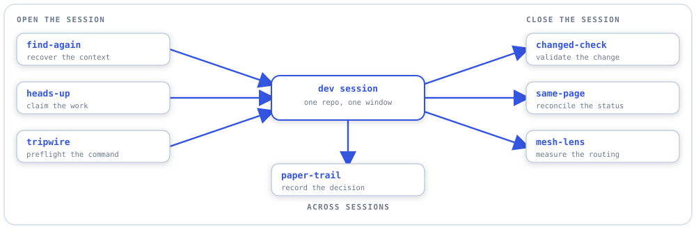

# tripwire

A local-first preflight utility that turns known workspace failure modes into fast,
evidence-bearing checks. Wrong working directories, wrong worktrees, broad staging, unsafe
process termination, and shell mismatches have recurred despite written guidance; tripwire
operationalizes a small, high-confidence subset of those rules as one-shot checks.

Two entry points:

- `tripwire check` — read-only repository/session-state probes for the current (or `--root`) tree.
- `tripwire command explain -- <command>` — classifies proposed command text for known risky shapes.

## Stack

| Tool | Why |
|---|---|
| Python 3.12+ | Implementation language |
| uv | Environment + dependency management |
| argparse | CLI (no third-party CLI dependency) |
| pytest | Table-driven fixture tests |
| Ruff | Lint + format |
| mypy (strict) | Static typing |

## Prerequisites

- Python 3.12+
- [uv](https://docs.astral.sh/uv/)

## Setup

```bash
uv sync --extra dev
uv run pytest -q          # tests
uv run ruff check .       # lint
uv run mypy --strict src  # types
```

## Usage

```bash
# Check the enclosing git root of the cwd (or an explicit --root)
uv run tripwire check
uv run tripwire check --root <path>

# Explain proposed command text
uv run tripwire command explain -- <command>
```

Exit codes: `0` no blocking findings, `1` blocking findings, `2` invalid input or incomplete
evaluation. JSON output carries the same distinction.

### Command classification

`command explain --json` keeps `schema_version` 1 and adds fields after `findings`:
`shell` (`powershell` or `unspecified`) and `unwrapped` (true or false), plus `inner_command`
when a wrapper was unwrapped. Readers of the original three fields are unaffected.

A PowerShell `-Command` wrapper is unwrapped and its inner command is classified as PowerShell.
Accepted shape, nothing else: the program is a quoted or unquoted path to `powershell.exe` or
`pwsh.exe` (or the bare names); optionally `-NoProfile`, `-NonInteractive`, `-NoLogo` (or `-nop`,
`-noni`, `-nol`) and `-ExecutionPolicy <value>`; then `-Command` or `-c` and exactly one argument.
The line is split by the Windows C-runtime rules (`\"` is a literal quote inside a quoted
argument). An unterminated quote, a `""` pair inside quotes, several arguments after `-Command`,
any other parameter (`-File`, `-EncodedCommand`) or an empty inner command is not unwrapped: the
text is classified as given, as before.

Heredoc and PowerShell here-string bodies are data (a commit message, a file being written) and
are removed before classification.

`TW-SEC-001` (secret-file dump) judges only the files a command prints. Since 0.1.2:

- a grep, `Select-String` or awk pattern is not a file (`grep -rn ".env" src` is quiet;
  `grep TOKEN .env` still fails);
- a redirect target is written, not printed (`cat > .env` is quiet; `cat < .env` fails);
- source and documentation files named after secrets (`secret-read-guard.py`,
  `secrets-handling.md`) are not secret stores;
- a substituted file operand (`cat $f`, `Get-Content $path`) is no longer reported as `unknown`.
  A 2026-11-23 replay of 8,247 real shell commands showed that branch produced 1,115 of the
  rule's 1,156 hook rows, and the hook never surfaces an `unknown`.

`tripwire --version` prints `tripwire <version>` and exits 0 (an install health check).

## Claude Code hook

tripwire ships an advisory PreToolUse hook for Claude Code (Windows PowerShell 5.1) inside the
package. It runs `tripwire command explain --json` on each Bash or PowerShell command that passes
a cheap in-process pre-screen.

```powershell
uv tool install --from <checkout or git URL> tripwire
tripwire hook path --host claude   # prints the installed hook's absolute path, one line
```

Copy that file wherever you keep hooks and register it under `hooks.PreToolUse` in a Claude Code
`settings.json`, with matcher `Bash|PowerShell`, `timeout` 5, `onFailure` `continue` and this
exact command line:

```text
powershell.exe -NoProfile -NonInteractive -File "<absolute hook path>"
```

### Codex CLI

The same script is the Codex CLI hook: `tripwire hook path --host codex` prints the same packaged
file. Register it in `~/.codex/hooks.json` under `PreToolUse` with matcher `^Bash$` and the same
command line. Codex sends the same payload (`tool_name`, `tool_input.command`, `cwd`) and reads
the same advisory output: its PreToolUse output schema accepts
`hookSpecificOutput.additionalContext` ("model-visible context without blocking"). Codex runs
every shell call as `tool_name` `Bash` with a command line such as
`"C:\Windows\System32\WindowsPowerShell\v1.0\powershell.exe" -Command "<real command>"`.
tripwire unwraps that line (see Command classification below), so the hook keeps `TW-SHL-001`
for it even though the tool name is `Bash`. A `tool_name` other than `Bash` or `PowerShell`
(Codex also hands hooks an `apply_patch` "command", which is patch text) is never evaluated.

What the hook does, and never does:

- **Observer only.** It exits 0 on every path and never emits `permissionDecision`, so it cannot
  block or approve a tool call.
- **At most one note.** It prints one `additionalContext` line for a `fail` finding. The only
  `warn` it notes is `TW-GIT-001` (broad staging) when the target git toplevel is a coding root
  (it carries `.claude/observatory/registry.toml`); a `fail` always takes precedence. Every other
  `warn` and every `unknown` stays silent.
- **Bounded.** One child call with a 3-second cap; on timeout the whole process tree is killed.
  stdout is capped at 256 KiB; stderr is discarded.
- **Shadow log.** Each pre-screen hit appends rows `{ts, tool, rule_id, severity, observed}` to
  `%LOCALAPPDATA%\tripwire\hook-shadow.jsonl`: one per finding, a `none` row when tripwire found
  nothing, or an `unavailable` row when the call failed or timed out. The command text is never
  logged; `observed` is redacted of every command fragment.
- **ASCII only.** Windows PowerShell 5.1 reads a no-BOM `.ps1` as cp1252.

The hook finds tripwire in this order, first match wins:

1. `tripwire.exe` on `PATH`;
2. `tripwire.exe` in the default user uv tool bin directory (`UV_TOOL_BIN_DIR`, else
   `XDG_BIN_HOME`, else `XDG_DATA_HOME\..\bin`, else `<user profile>\.local\bin`);
3. when `DEV_UTILITIES_ROOT` is set and non-empty and
   `$DEV_UTILITIES_ROOT\tripwire\pyproject.toml` exists,
   `uv run --project "$DEV_UTILITIES_ROOT\tripwire" tripwire ...`;
4. otherwise it does nothing (no note, no log row, no child process).

Only an `.exe` is accepted in steps 1 and 2: a `.cmd` or `.bat` shim would pass the command text
through `cmd.exe` parsing. The open project (`CLAUDE_PROJECT_DIR`, the payload `cwd`) is never a
source: a repository you open could ship its own `tripwire/pyproject.toml`, and running it would
execute that repository's code under your account.

The behavioural suite runs the hook through that registered command line, from an installed copy:

```powershell
powershell -NoProfile -ExecutionPolicy Bypass -File tests/hooks/tripwire-pretool.tests.ps1
```

`uv run pytest -q` runs it too (`tests/test_hook_powershell.py`), together with a red-on-garbage
run against `tests/hooks/fixtures/garbage-hook.ps1` that must fail.

## Design decisions

- **One rule owner.** Workspace checks and command explanations share IDs, severity, rationale,
  and provenance in a single registry (`rules.py`); a rule may expose one or both evaluators.
- **Evidence before verdict.** Every `warn`/`fail` carries the observed value and its source rule.
  Unknown or unparsed input is explicit — it never becomes a success-shaped result.
- **Strict admission bar.** v1 contains only rules backed by a written workspace policy or a
  recorded incident plus a stable fixture pair.
- **Rule identifiers.** Versioned categorical IDs `TW-<AREA>-<NNN>@v<M>` (e.g. `TW-GIT-001@v1`),
  defined once in `rules.py`; a semantic change bumps `@v<M>` (bump = supersede).

## Project structure

```
src/tripwire/
  models.py      finding / evidence / severity / report shapes
  rules.py       canonical rule registry with provenance
  workspace.py   read-only git / worktree / session probes
  command.py     conservative command tokenizer + classifier
  cli.py         check + command explain + hook path entry points
  hook_assets.py locate the packaged host hooks
hooks/claude/    the Claude Code PreToolUse hook (shipped inside the package)
tests/fixtures/  frozen good / bad / ambiguous cases
tests/hooks/     PowerShell behavioural suite for the hook + its garbage anchor
```

See [plans/plan.md](plans/plan.md) for the full build plan and the v1 rule inventory.

## Scope

**In:** read-only workspace probes, command-text classification, versioned rule IDs, text + JSON
reports, Windows path normalization. **Out:** command execution, shell interception, automatic
fixes, remote policy, and any assurance that an unflagged command is safe.

## Sibling utilities

<picture>
  <source media="(prefers-color-scheme: dark)" srcset="assets/utility-family-dark.svg">
  
</picture>

One of seven local-first utilities for a dev workspace. Each is a standalone CLI with no shared
runtime and no cross-imports; where two of them meet, the seam is a file-format contract, so any
one of them can be replaced without touching the others.

- [find-again](https://github.com/aberson/find-again) - local full-text search across dev-memory artifacts
- [heads-up](https://github.com/aberson/heads-up) - advisory expiring claims across parallel sessions
- [tripwire](https://github.com/aberson/tripwire) - preflight checks on repo state and commands (you are here)
- [changed-check](https://github.com/aberson/changed-check) - narrowest declared validation for a change set
- [same-page](https://github.com/aberson/same-page) - deterministic contradiction detection across status artifacts
- [mesh-lens](https://github.com/aberson/mesh-lens) - cohort analysis of skill and model telemetry
- [paper-trail](https://github.com/aberson/paper-trail) - immutable decision records with explicit supersession

More at [github.com/aberson](https://github.com/aberson) and [aberson.github.io](https://aberson.github.io).
